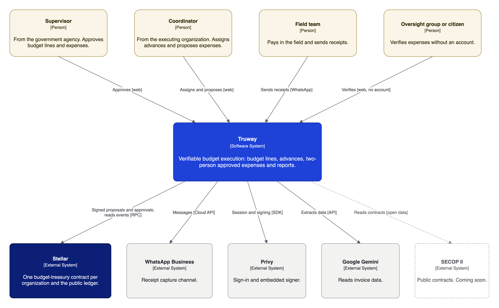
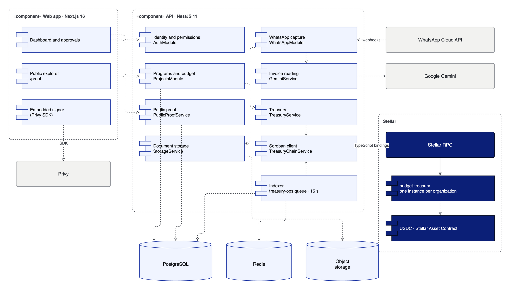

# Architecture

Members of each organization propose and approve in their own `budget-treasury` contract on Stellar. The Truway platform builds those transactions, stores documents and indexes events. Anyone can read the result.

## Context

<figure><figcaption>
System context (C4, level 1)
</figcaption></figure>

## Components

<figure><figcaption>
Components (UML)
</figcaption></figure>

| Layer | What it does | Who controls it |
|---|---|---|
| **Members** (admins, approvers, operators) | Propose and approve, each with their own key | The organization |
| **Web app and WhatsApp channel** | Capture invoices, show budgets and request approvals | Truway |
| **Truway API** | Builds each transaction for the member who must sign it, stores documents and their SHA-256, indexes events | Truway |
| **`budget-treasury`** | Enforces the rules: two signers, budget limits, single-use documents, account codes | Its members; Truway deploys it but is never a member |
| **Proof of Spend events** | The public interface | Nobody: they are on the ledger |

`RecordExpense` records an expense paid by bank or cash and moves no funds. `Pay` pays from funds held in the contract.

## What lives on the ledger and what lives off it

| Data | Where | Form |
|---|---|---|
| Budget per line and source, with chart, account and currency | Ledger | Amounts and codes; identifiers as SHA-256 |
| Expense: amount, line, account, proposer, approver | Ledger | Addresses and amounts |
| Supporting document fingerprint | Ledger | SHA-256 of the file |
| Supporting document file | Truway's private storage | File |
| Supplier tax ID | Truway's database; on the ledger as `payee_ref` | SHA-256 |
| Names of people, projects and suppliers | Truway's database | Text |

Events never carry personal data.

## Design decisions

* [ADR 0003](https://github.com/truway-xyz/soroban-contracts/blob/main/docs/adr/0003-members-sign-proof-of-spend.md): members sign, and records follow Proof of Spend. Supersedes ADR 0002 (server-attested records).
* One instance per organization: no organization can touch another's record.
* Narrow contract, business logic above it: the contract enforces money rules; capture, invoice reading and reporting live off chain.
