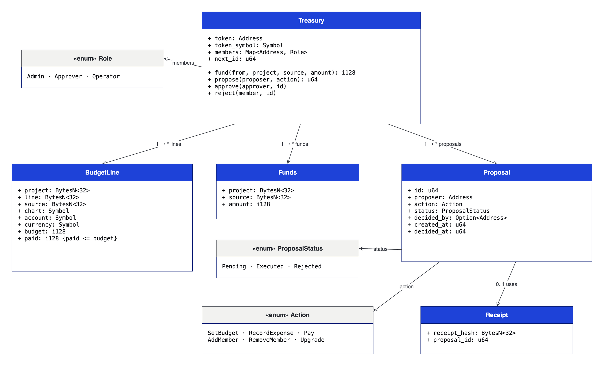

# budget-treasury

Soroban contract that implements [Proof of Spend](../proof-of-spend/proof-of-spend.md). One instance is deployed per organization.

|               |                                                                                                                    |
| ------------- | ------------------------------------------------------------------------------------------------------------------ |
| Version       | `0.4.0`                                                                                                            |
| Source        | [`contracts/budget-treasury`](https://github.com/truway-xyz/soroban-contracts/tree/main/contracts/budget-treasury) |
| Toolchain     | Rust 1.96.0 · `soroban-sdk` 29.0.1 (protocol 29) · `wasm32v1-none` · Stellar CLI 27                                |
| Contract meta | `event_schema = proof-of-spend/1`                                                                                  |
| License       | Apache-2.0                                                                                                         |

## Data model

<figure><figcaption><p>Contract class diagram (UML)</p></figcaption></figure>

| Key                                         | Storage    | Value                               |
| ------------------------------------------- | ---------- | ----------------------------------- |
| `Token`, `TokenSymbol`, `Members`, `NextId` | Instance   | Read by most calls                  |
| `Proposal(id)`                              | Persistent | One per proposal                    |
| `Line(LineKey)`                             | Persistent | One per project, line and source    |
| `Funds(FundKey)`                            | Persistent | One per project and source          |
| `Receipt(hash)`                             | Persistent | The proposal that used the document |

## Roles

| Role       | Can propose           | Can approve or reject          |
| ---------- | --------------------- | ------------------------------ |
| `Admin`    | Anything              | Any proposal of another member |
| `Approver` | Nothing               | Budgets, expenses and payments |
| `Operator` | Expenses and payments | Nothing                        |

## Actions

| Action                    | What it does                                                                              | Moves funds |
| ------------------------- | ----------------------------------------------------------------------------------------- | ----------- |
| `SetBudget(BudgetChange)` | Creates or changes a line with `chart`, `account`, `currency` and amount                  | No          |
| `RecordExpense(Expense)`  | Records an expense paid off the ledger with `receipt_hash`, `payment_ref` and `payee_ref` | No          |
| `Pay(Payment)`            | Pays from the contract's funds to an address                                              | Yes         |
| `AddMember(MemberChange)` | Adds a member or changes their role                                                       | No          |
| `RemoveMember(Address)`   | Removes a member                                                                          | No          |
| `Upgrade(BytesN<32>)`     | Replaces the code                                                                         | No          |

## Interface

```rust
__constructor(admins: Vec<Address>, token: Address, token_symbol: Symbol)
fund(from: Address, project: BytesN<32>, source: BytesN<32>, amount: i128) -> Result<i128, Error>
propose(proposer: Address, action: Action) -> Result<u64, Error>
approve(approver: Address, id: u64) -> Result<(), Error>
reject(member: Address, id: u64) -> Result<(), Error>

// Read
token() -> Address
token_symbol() -> Symbol
role(member: Address) -> Option<Role>
members() -> Map<Address, Role>
line(project: BytesN<32>, line: BytesN<32>, source: BytesN<32>) -> Option<BudgetLine>
funds(project: BytesN<32>, source: BytesN<32>) -> i128
receipt_use(receipt_hash: BytesN<32>) -> Option<u64>
proposal(id: u64) -> Option<Proposal>
```

## Rules

* At least **two distinct admins** at construction.
* At most **32 members**.
* At least one admin and two members able to approve always remain.
* On every line, `paid <= budget`.
* A payment never exceeds its source's funds for the project.
* An expense books to its line's `chart` and carries a `receipt_hash` that backs no other expense in the same treasury.
* Fixed point with 7 decimals: 45,000 COP is `450000000000`.

Error codes: [Errors](errors.md).
