# Deployment

<figure><figcaption><p>Platform deployment</p></figcaption></figure>

| Service | Address |
|---|---|
| App | `app.truway.xyz` |
| API | `api.truway.xyz` |
| Website | `truway.xyz` |
| Network | Stellar testnet |

## Contract instances

The source of truth is [`deployments/`](https://github.com/truway-xyz/soroban-contracts/tree/main/deployments) in `soroban-contracts`. This table is generated from it.

<!-- GENERATED:deployments:start -->
**testnet**

| Contract | Version | Contract ID | WASM hash | Commit | Deployed | Build verified |
|---|---|---|---|---|---|---|
| `budget-treasury` | 0.4.0 | [`CCDKD5G2…WWZN`](https://stellar.expert/explorer/testnet/contract/CCDKD5G2OPQUCAWODXWR7JPZJWENNZMKQU5E3J6HSPIUY5ZFWC3QWWZN) | `183dd156444f…` | `6a5acb6` | 2026-11-07 | false |

**mainnet**

No active instances.

_Generated from `deployments/` at soroban-contracts commit `bb8e6e3`._
<!-- GENERATED:deployments:end -->

Each organization has its own instance, deployed from a single-use account that is not a member. To check that a treasury runs the published code:

```bash
stellar contract fetch --id <CONTRACT_ID> --network testnet --out-file t.wasm && shasum -a 256 t.wasm
```

## Verified builds

On every version tag, the [release workflow](https://github.com/truway-xyz/soroban-contracts/blob/main/.github/workflows/release.yml) builds `budget-treasury` on GitHub, attests the WASM and attaches it to the release. Stellar Lab and Stellar Expert read that attestation and show the source commit. Only the release WASM verifies; a local build has a different hash.

Instances marked as retired in the manifest, and the July 2026 instances of the earlier contracts, must not be used.
