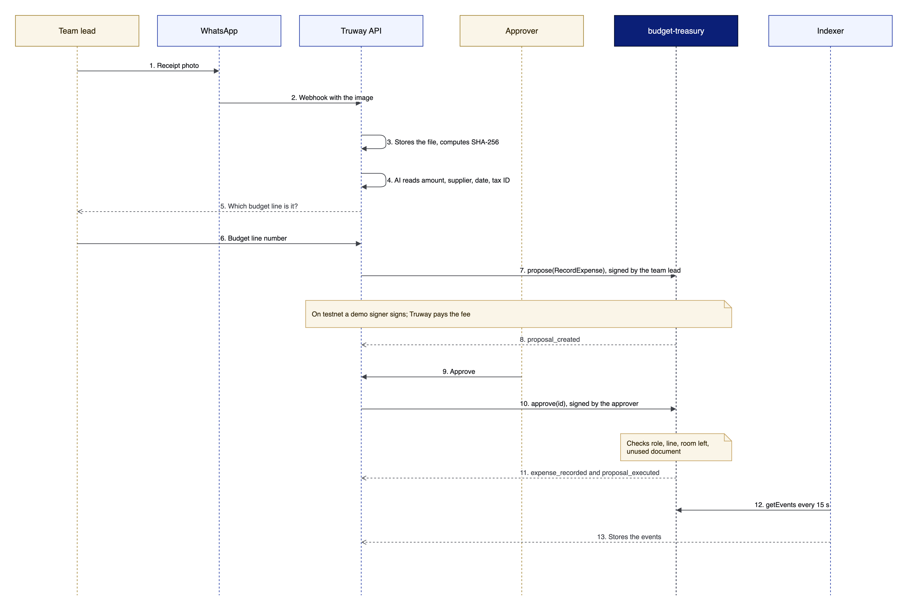

# Lifecycle of an expense

## Expense paid by bank or cash

<figure><figcaption>
Sequence of an expense on Stellar
</figcaption></figure>

1. The team pays and captures the receipt. The platform stores the file and computes its SHA-256.
2. `RecordExpense` is proposed with the line, source, amount, account, `receipt_hash` and hashed references to the payment and the payee.
3. The contract checks the role, that the document is unused, that the line exists in the same chart and that there is room left.
4. Another member approves. The contract checks everything again, adds the amount to the line, marks the document as used and emits `expense_recorded` and `proposal_executed`.
5. The indexer stores the events and the explorer shows them.


On testnet, each person's step is signed by a demo signer held by the platform. See [Signing and fees](signing-and-fees.md).


## Proposal states

| Contract state | App status |
|---|---|
| `Pending` | Waiting for approval |
| Approved and submitted | Recording… |
| `Executed`, event indexed | Registered · verifiable |
| `Rejected` | Rejected |

An admin, an approver (except for membership or code changes) or the proposer can reject.

## Payment from the contract's funds

1. A funder calls `fund` and deposits the treasury asset for a project and a source. `project_funded` is emitted.
2. A member proposes `Pay` with the destination, line, source and document. The line must be in the treasury asset and the source must hold enough funds.
3. Another member approves. The contract transfers, updates the line and the funds, and emits `payment_executed` and `proposal_executed`.

`Pay` is built into the contract and tested on testnet; it is not part of the app flow yet.
