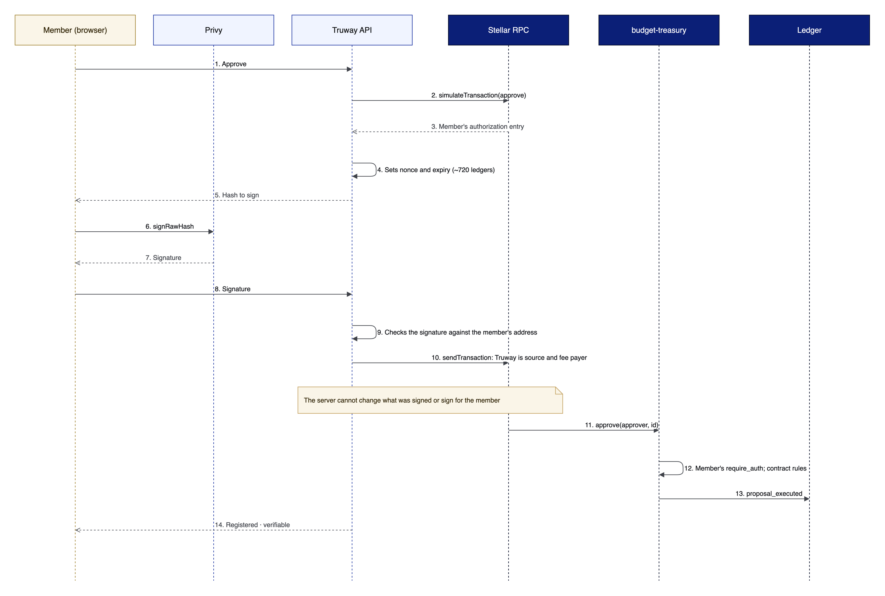

# Signing and fees

Each member authorizes only their own step. Truway builds the transaction, pays the fee and submits it, but cannot change what the member signed.


On testnet, while per-person signing is being built, the platform holds demo signers. They appear in the app as **Demo signer** and are never used on mainnet.


## Per-person signing

<figure><figcaption>
Per-person signing sequence (design)
</figcaption></figure>

1. The member presses **Approve**.
2. The API builds `approve(approver, id)`, simulates it and takes the member's authorization entry, with a nonce and an expiry of about 720 ledgers (roughly one hour).
3. The browser signs the hash with the member's key, held by Privy, with no pop-up and no seed phrase.
4. The API checks the signature, simulates again, wraps the invocation in a transaction whose source is Truway, and submits it through a queue.

If submission fails, the API retries with a new envelope while the authorization has not expired. The authorization is bound to the exact arguments, so it cannot be reused for anything else.

## Fees

Truway pays every network fee and rent. Members hold no XLM. This is the fee sponsorship through a relayer pattern from Stellar's docs: the user signs only the authorization entries and the relayer submits with its own account. For parallel submission, the documented option is [OpenZeppelin Relayer](https://developers.stellar.org/docs/tools/openzeppelin-relayer) with Channels.

## Accounts

| Account | Purpose | Who holds the key |
|---|---|---|
| Member account | Propose and approve in their organization's treasury | The member, through Privy |
| Demo signer | Stands in for a member on testnet | The platform |
| Own account | For people who already use a Stellar wallet; signs in with SEP-10 | The person |
| Truway submitter | Pays fees and submits | Truway |
| Deployer | Creates a treasury; used once, never a member | Truway |

If members later use contract accounts with passkeys (CAP-51), authentication with services follows SEP-45.
