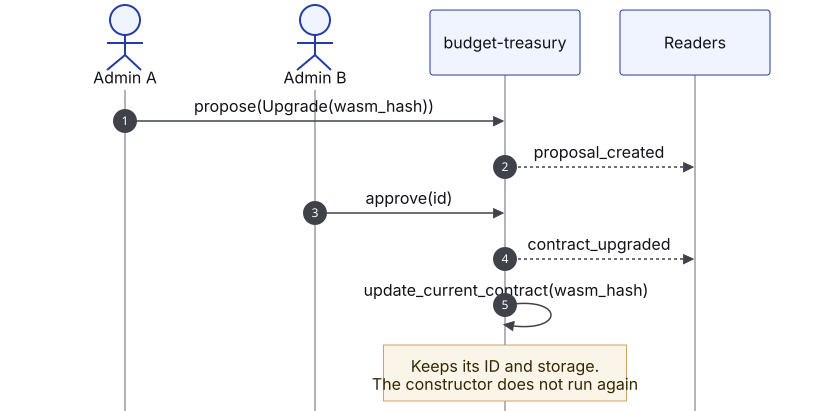

# Contract upgrades

<figure><figcaption>
Upgrade with two admins
</figcaption></figure>

1. The new WASM is uploaded (`stellar contract upload`) and its hash obtained.
2. An admin proposes `Upgrade(wasm_hash)`.
3. Another admin approves it.
4. The contract emits `contract_upgraded` and **then** replaces its code with `update_current_contract`.

Events after `contract_upgraded` come from the new code. The contract keeps its ID and storage; the constructor does not run again.

## Compatibility rules

* `DataKey` variants are not renamed, reordered or removed without a migration.
* New stored fields are `Option<T>`.
* Event fields never change; breaking changes get a new standard identifier.
* Error codes are never renumbered.

Each organization controls its own treasury's upgrades. Truway does not use executable references (CAP-85).

## Pending before mainnet

| Pending | Finding |
|---|---|
| Approval by several admins for members and code | BT-07 |
| Proposal expiry | BT-08 |
| A pause any admin can trigger and two can lift | BT-09 |
| Timelock on upgrades | BT-07 |
| Exercise the code swap on testnet | BT-13 |
