# Proof of Spend

**Payments prove the money moved. Proof of Spend proves what it bought.**

Proof of Spend (`proof-of-spend/1`) is an open standard for budget execution on Stellar. A contract that implements it records, for every expense or payment, against which budget line, from which funder, booked to which account, backed by which document and approved by whom.

| | |
|---|---|
| Identifier | `proof-of-spend/1` |
| Version | Draft 2, 2026-11-07 |
| License | Apache-2.0 |
| Reference implementation | [`budget-treasury`](../developers/budget-treasury.md) |
| Source | [`soroban-contracts/docs/proof-of-spend.md`](https://github.com/truway-xyz/soroban-contracts/blob/main/docs/proof-of-spend.md) |

<figure><figcaption>
From events to reports
</figcaption></figure>

## Scope

* Budget lines per project and funding source, with an account code and a currency.
* Expenses paid outside the ledger and payments made on it, with their account and the fingerprint of their supporting document.
* The two-person approval behind every change.
* Money held on the ledger, earmarked by funding source.

Not covered yet: procurement, payments to individual beneficiaries and impact milestones.

## Conformance

A contract conforms to `proof-of-spend/1` when it:

1. declares `event_schema = proof-of-spend/1` in its contract meta (`contractmetav0`);
2. emits the standard events with their exact names, topics and fields;
3. enforces every invariant.

## Invariants

1. Every budget change, expense and payment is proposed by one member and approved by another.
2. Membership and code changes are approved by an admin.
3. No budget line spends more than its budget.
4. Every expense is charged to exactly one line.
5. Every expense carries a supporting document, and a document backs at most one expense per contract.
6. Every expense books to its line's chart of accounts.
7. The treasury always keeps enough members to approve.
8. Every amount is positive.

## Next

* [Specification](specification.md)
* [Reading the record](reading-the-record.md)
* [Implementing the standard](implementing.md)
