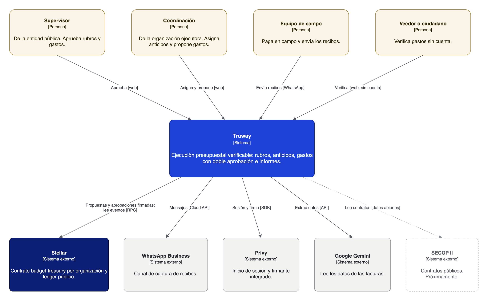
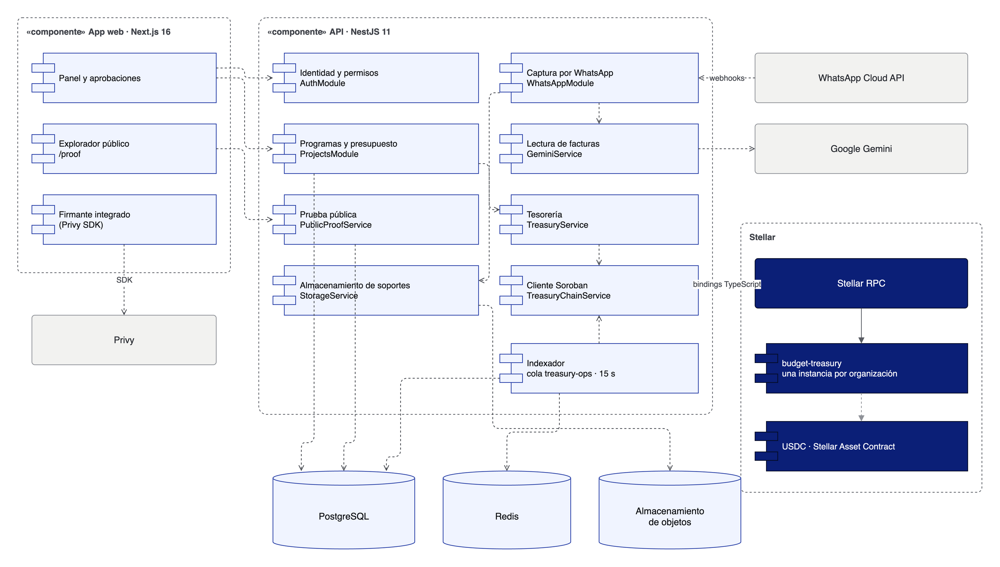

# Arquitectura

Los miembros de cada organización proponen y aprueban en su propio contrato `budget-treasury` en Stellar. La plataforma de Truway arma esas transacciones, guarda los documentos e indexa los eventos. Cualquiera puede leer el resultado.

Código abierto bajo Apache-2.0. El repositorio contiene `budget-treasury`, la implementación de referencia de Proof of Spend.

<a href="https://github.com/truway-xyz/soroban-contracts" class="button primary">Ver los contratos en GitHub</a>

## Contexto

<figure><figcaption>
Contexto del sistema (C4, nivel 1)
</figcaption></figure>

## Componentes

<figure><figcaption>
Componentes (UML)
</figcaption></figure>

| Capa | Qué hace | Quién la controla |
|---|---|---|
| **Miembros** (administradores, aprobadores, operadores) | Proponen y aprueban, cada uno con su llave | La organización |
| **App web y canal de WhatsApp** | Capturan facturas, muestran presupuestos y piden aprobaciones | Truway |
| **API de Truway** | Arma cada transacción para quien debe firmarla, guarda documentos y su SHA-256, indexa eventos | Truway |
| **`budget-treasury`** | Hace cumplir las reglas: dos firmantes, límite del rubro, soporte de un solo uso, cuenta contable | Sus miembros; Truway lo despliega pero nunca es miembro |
| **Eventos Proof of Spend** | La interfaz pública | Nadie: están en el ledger |

`RecordExpense` registra un gasto pagado por banco o en efectivo y no mueve fondos. `Pay` paga desde fondos que tenga el contrato.

## Arquitectura en Stellar

<figure><figcaption>
Arquitectura en Stellar: contratos, cuentas e integraciones
</figcaption></figure>

## Qué vive en la red y qué fuera

| Dato | Dónde | Forma |
|---|---|---|
| Presupuesto por rubro y fuente, con plan, cuenta y moneda | Ledger | Valores y códigos; identificadores como SHA-256 |
| Gasto: valor, rubro, cuenta, proponente, aprobador | Ledger | Direcciones y valores |
| Huella del soporte | Ledger | SHA-256 del archivo |
| Archivo del soporte | Almacenamiento privado de Truway | Archivo |
| NIT del proveedor | Base de datos de Truway; en el ledger como `payee_ref` | SHA-256 |
| Nombres de personas, proyectos y proveedores | Base de datos de Truway | Texto |

Los eventos nunca llevan datos personales.

## Decisiones de diseño

* [ADR 0003](https://github.com/truway-xyz/soroban-contracts/blob/main/docs/adr/0003-members-sign-proof-of-spend.md): firman los miembros y los registros siguen Proof of Spend. Reemplaza al ADR 0002, de registros atestados por el servidor.
* Una instancia por organización: ninguna organización puede tocar el registro de otra.
* Contrato estrecho y lógica de negocio encima: el contrato hace cumplir las reglas del dinero; la captura, la lectura de facturas y los informes viven fuera.
