# budget-treasury

Contrato Soroban que implementa [Proof of Spend](../proof-of-spend/README.md). Se despliega una instancia por organización.

| | |
|---|---|
| Versión | `0.4.0` |
| Código | [`contracts/budget-treasury`](https://github.com/truway-xyz/soroban-contracts/tree/main/contracts/budget-treasury) |
| Toolchain | Rust 1.96.0 · `soroban-sdk` 29.0.1 (protocolo 29) · `wasm32v1-none` · Stellar CLI 27 |
| Metadata | `event_schema = proof-of-spend/1` |
| Licencia | Apache-2.0 |

## Modelo de datos

<figure><figcaption><p>Entidades del contrato</p></figcaption></figure>

| Clave | Almacenamiento | Valor |
|---|---|---|
| `Token`, `TokenSymbol`, `Members`, `NextId` | Instancia | Se leen en casi todas las llamadas |
| `Proposal(id)` | Persistente | Una por propuesta |
| `Line(LineKey)` | Persistente | Una por proyecto, rubro y fuente |
| `Funds(FundKey)` | Persistente | Una por proyecto y fuente |
| `Receipt(hash)` | Persistente | La propuesta que usó el soporte |

## Roles

| Rol | Puede proponer | Puede aprobar o rechazar |
|---|---|---|
| `Admin` | Todo | Cualquier propuesta de otro miembro |
| `Approver` | Nada | Presupuestos, gastos y pagos |
| `Operator` | Gastos y pagos | Nada |

## Acciones

| Acción | Qué hace | Mueve fondos |
|---|---|---|
| `SetBudget(BudgetChange)` | Crea o cambia un rubro con `chart`, `account`, `currency` y monto | No |
| `RecordExpense(Expense)` | Registra un gasto pagado fuera de la red con `receipt_hash`, `payment_ref` y `payee_ref` | No |
| `Pay(Payment)` | Paga desde los fondos del contrato a una dirección | Sí |
| `AddMember(MemberChange)` | Agrega un miembro o cambia su rol | No |
| `RemoveMember(Address)` | Quita un miembro | No |
| `Upgrade(BytesN<32>)` | Reemplaza el código | No |

## Interfaz

```rust
__constructor(admins: Vec<Address>, token: Address, token_symbol: Symbol)
fund(from: Address, project: BytesN<32>, source: BytesN<32>, amount: i128) -> Result<i128, Error>
propose(proposer: Address, action: Action) -> Result<u64, Error>
approve(approver: Address, id: u64) -> Result<(), Error>
reject(member: Address, id: u64) -> Result<(), Error>

// Lectura
token() -> Address
token_symbol() -> Symbol
role(member: Address) -> Option<Role>
members() -> Map<Address, Role>
line(project: BytesN<32>, line: BytesN<32>, source: BytesN<32>) -> Option<BudgetLine>
funds(project: BytesN<32>, source: BytesN<32>) -> i128
receipt_use(receipt_hash: BytesN<32>) -> Option<u64>
proposal(id: u64) -> Option<Proposal>
```

## Reglas

* Al menos **dos administradores distintos** al crearse.
* Como máximo **32 miembros**.
* Siempre queda al menos un administrador y dos miembros que pueden aprobar.
* En cada rubro, `paid <= budget`.
* Un pago no supera los fondos de su fuente para el proyecto.
* Un gasto se asienta en el `chart` de su rubro y lleva un `receipt_hash` que no respalda otro gasto de la misma tesorería.
* Valores en punto fijo con 7 decimales: 45.000 COP es `450000000000`.

Códigos de error: [Errores](errores.md).
