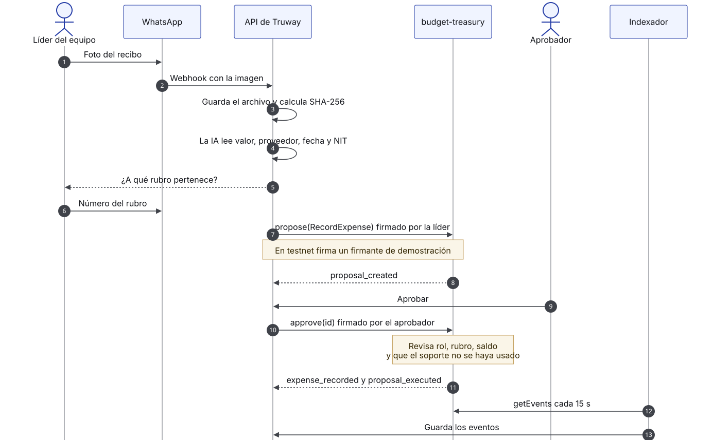

# Ciclo de vida de un gasto

## Gasto pagado por banco o en efectivo

<figure><figcaption>
De la foto del recibo al evento en el ledger
</figcaption></figure>

1. El equipo paga y captura el recibo. La plataforma guarda el archivo y calcula su SHA-256.
2. Se propone `RecordExpense` con rubro, fuente, valor, cuenta, `receipt_hash` y la huella de las referencias del pago y del proveedor.
3. El contrato revisa el rol, que el soporte no se haya usado, que el rubro exista en el mismo plan y que haya saldo.
4. Otro miembro aprueba. El contrato revisa todo de nuevo, suma el valor al rubro, marca el soporte como usado y emite `expense_recorded` y `proposal_executed`.
5. El indexador guarda los eventos y el explorador los muestra.


En testnet, los pasos de cada persona los firman firmantes de demostración custodiados por la plataforma. Ver [Firma y comisiones](firma-y-comisiones.md).


## Estados de una propuesta

<figure><figcaption>
Máquina de estados
</figcaption></figure>

| Estado en el contrato | Estado en la app |
|---|---|
| `Pending` | Esperando aprobación |
| Aprobada y enviada | Registrando… |
| `Executed`, evento indexado | Registrado · verificable |
| `Rejected` | Rechazado |

Pueden rechazar un administrador, un aprobador (salvo cambios de miembros o de código) o quien la propuso.

## Pago desde fondos del contrato

1. Un financiador llama a `fund` y deposita el activo de la tesorería para un proyecto y una fuente. Se emite `project_funded`.
2. Un miembro propone `Pay` con la dirección de destino, el rubro, la fuente y el soporte. El rubro debe estar en el activo de la tesorería y la fuente debe tener fondos.
3. Otro miembro aprueba. El contrato transfiere, actualiza el rubro y los fondos, y emite `payment_executed` y `proposal_executed`.

`Pay` está construido en el contrato y probado en testnet; todavía no forma parte del flujo de la app.
