# Despliegue

<figure><figcaption><p>Despliegue de la plataforma</p></figcaption></figure>

| Servicio | Dirección |
|---|---|
| App | `app.truway.xyz` |
| API | `api.truway.xyz` |
| Sitio web | `truway.xyz` |
| Red | Stellar testnet |

## Instancias del contrato

La fuente de verdad es [`deployments/`](https://github.com/truway-xyz/soroban-contracts/tree/main/deployments) en `soroban-contracts`. Esta tabla se genera desde ahí.

<!-- GENERATED:deployments:start -->
**testnet**

| Contract | Version | Contract ID | WASM hash | Commit | Deployed | Build verified |
|---|---|---|---|---|---|---|
| `budget-treasury` | 0.4.0 | [`CCDKD5G2…WWZN`](https://stellar.expert/explorer/testnet/contract/CCDKD5G2OPQUCAWODXWR7JPZJWENNZMKQU5E3J6HSPIUY5ZFWC3QWWZN) | `183dd156444f…` | `6a5acb6` | 2026-11-07 | false |

**mainnet**

No active instances.

_Generated from `deployments/` at soroban-contracts commit `bb8e6e3`._
<!-- GENERATED:deployments:end -->

Cada organización tiene su propia instancia, desplegada desde una cuenta de un solo uso que no es miembro. Para comprobar que una tesorería corre el código publicado:

```bash
stellar contract fetch --id <CONTRACT_ID> --network testnet --out-file t.wasm && shasum -a 256 t.wasm
```

## Builds verificados

Con cada etiqueta de versión, el [workflow de release](https://github.com/truway-xyz/soroban-contracts/blob/main/.github/workflows/release.yml) compila `budget-treasury` en GitHub, atesta el WASM y lo adjunta al release. Stellar Lab y Stellar Expert leen esa atestación y muestran el commit de origen. Solo verifica el WASM del release; un build local tiene otro hash.

Las instancias marcadas como retiradas en el manifiesto, y las de julio de 2026 de los contratos anteriores, no se deben usar.
