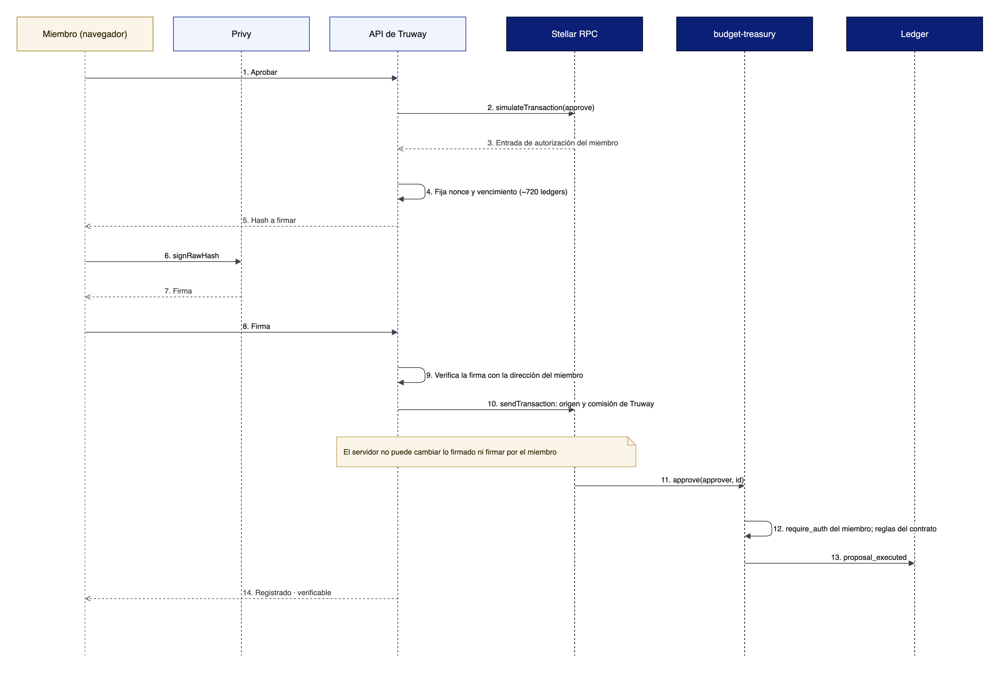

# Firma y comisiones

Cada miembro autoriza solo su propio paso. Truway arma la transacción, paga la comisión y la envía, pero no puede cambiar lo que el miembro firmó.


En testnet, mientras se construye la firma por persona, la plataforma custodia firmantes de demostración. En la app aparecen como **Demo signer** y nunca se usan en mainnet.


## Firma por persona

<figure><figcaption>
Secuencia de la firma por persona (diseño)
</figcaption></figure>

1. El miembro presiona **Aprobar**.
2. La API arma `approve(approver, id)`, la simula y toma la entrada de autorización del miembro, con *nonce* y un vencimiento de unas 720 ledgers (cerca de una hora).
3. El navegador firma el hash con la llave del miembro, guardada por Privy, sin ventanas ni frases semilla.
4. La API verifica la firma, simula de nuevo, envuelve la invocación en una transacción cuyo origen es Truway y la envía por una cola.

Si el envío falla, la API reintenta con un sobre nuevo mientras la autorización no venza. La autorización está atada a los argumentos exactos, así que no sirve para otra cosa.

## Comisiones

Truway paga todas las comisiones y la renta. Los miembros no necesitan XLM. Es el patrón de *fee sponsorship* por relayer de la documentación de Stellar: el usuario firma solo las entradas de autorización y el relayer envía con su cuenta. Para envío en paralelo, la opción documentada es [OpenZeppelin Relayer](https://developers.stellar.org/docs/tools/openzeppelin-relayer) con Channels.

## Cuentas

| Cuenta | Para qué | Quién tiene la llave |
|---|---|---|
| Cuenta del miembro | Proponer y aprobar en la tesorería de su organización | El miembro, por Privy |
| Firmante de demostración | Reemplaza a un miembro en testnet | La plataforma |
| Cuenta propia | Para quien ya usa una billetera Stellar; inicia sesión con SEP-10 | La persona |
| Remitente de Truway | Paga comisiones y envía | Truway |
| Cuenta de despliegue | Crea una tesorería; se usa una vez y nunca es miembro | Truway |

Si más adelante los miembros usan cuentas de contrato con passkeys (CAP-51), la autenticación con servicios sigue SEP-45.
